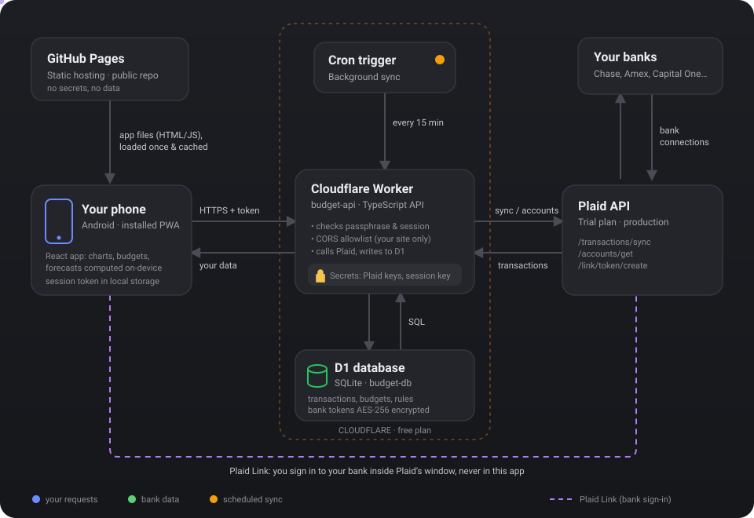

# Budget

A mobile-first budget tracker that pulls live balances and transactions from your banks through Plaid.

- **Frontend:** React + Vite PWA, hosted on GitHub Pages (`web/`)
- **API:** Cloudflare Worker + D1 (SQLite), free tier (`worker/`)
- **Auth:** single-user passphrase → signed 30-day session token

**Screens:** Home (customizable: drag to reorder or hide net worth, forecast, upcoming bills, insights, accounts, categories, recurring), Categories (tappable donut with subcategory breakdown), Analytics (income/expense trends, cash flow, averages), Transactions (search, list or calendar, filters, recategorize, notes, track as bill), Accounts (link/reconnect/unlink, rename, hide, statement access), Recurring charges, and auto-categorize Rules.

## Architecture



The full write-up covers each flow step by step (sign-in, linking a bank, syncing), the data model, how categories are decided, and the security model: **[docs/ARCHITECTURE.md](docs/ARCHITECTURE.md)**.

Plaid secrets and bank access tokens never reach the browser. The Worker:

- requires a valid session for every endpoint except `/api/health` and `/api/login`
- verifies the passphrase against a PBKDF2 hash and throttles failed logins (5 per IP per 15 min, 25 global per hour)
- only answers CORS requests from origins in `ALLOWED_ORIGINS` and rejects writes from any other origin
- encrypts Plaid access tokens with AES-256-GCM before storing them
- supports "Sign out on all devices", which revokes every issued session

## Prerequisites

- Node.js 22+ (`.nvmrc`)
- A [Plaid](https://dashboard.plaid.com) account. Sandbox keys are free with fake data. The free Trial plan gives real Production data for up to 10 bank connections.
- A free [Cloudflare](https://dash.cloudflare.com/sign-up) account
- A GitHub account. Free accounts need a **public** repo for GitHub Pages. That's fine here because the repo holds no secrets or financial data.

```bash
npm install
```

## 1. Deploy the API (Cloudflare Worker)

```bash
cd worker
npx wrangler login
npx wrangler d1 create budget-db       # copy the database_id into wrangler.jsonc
npm run db:migrate:remote
```

Edit `worker/wrangler.jsonc`:

- `ALLOWED_ORIGINS`: `https://<your-github-username>.github.io` (origin only, no path)
- `PLAID_ENV`: `sandbox` to start, `production` when you want real banks

Set the secrets:

```bash
npx wrangler secret put PLAID_CLIENT_ID
npx wrangler secret put PLAID_SECRET          # the secret for the PLAID_ENV you chose
npm run secrets -- --deploy                   # prompts for a passphrase (12+ chars), uploads
                                              # PASSPHRASE_HASH, SESSION_SECRET, TOKEN_ENCRYPTION_KEY
npm run deploy
```

Note the URL it prints, e.g. `https://budget-api.<you>.workers.dev`.

> To change only your passphrase later: `npm run secrets -- --deploy --only-passphrase`.
> Don't regenerate `TOKEN_ENCRYPTION_KEY` unless you're ready to relink every bank.

## 2. Deploy the web app (GitHub Pages)

```bash
git init -b main
git add .
git commit -m "Budget app"
git remote add origin https://github.com/<you>/Budget-Webapp.git
git push -u origin main
```

In the GitHub repo:

1. **Settings → Pages → Build and deployment → Source: GitHub Actions**
2. **Settings → Secrets and variables → Actions → Variables → New variable**: `VITE_API_URL` = your Worker URL
3. **Actions → Deploy web app to GitHub Pages → Run workflow** (it also runs on every push to `main` that touches `web/`)

Open `https://<you>.github.io/Budget-Webapp/` on your phone, sign in, and use **Share → Add to Home Screen** to install it.

## 3. Going live with real banks

1. In the Plaid dashboard, get Production access through the Trial plan.
2. Set `PLAID_ENV` to `production` in `wrangler.jsonc`, update the `PLAID_SECRET` secret to your Production secret, and run `npm run deploy`.
3. Recommended for banks that use OAuth (Chase, Capital One, Schwab and others), especially from the installed home-screen app: register `https://<you>.github.io/Budget-Webapp/` under **Allowed redirect URIs** in the Plaid dashboard, then set `PLAID_REDIRECT_URI` to the same value and redeploy. Without it, Plaid falls back to a popup flow.

Sandbox test login: username `user_good`, password `pass_good`.

## Deploying updates

- **Web app:** `git push`. GitHub Actions rebuilds and publishes Pages.
- **Worker and database:** `npm run deploy:worker` from the project root. It applies any new migrations first, then deploys the Worker. If a change touches both, run this **before** pushing.

To have pushes deploy the Worker too, see **[docs/ci-cd/](docs/ci-cd/README.md)**. It includes a ready-made workflow (not enabled) and the security tradeoffs of giving GitHub a Cloudflare token.

## Local development

```bash
cp worker/.dev.vars.example worker/.dev.vars
npm run secrets -w worker          # paste the printed values into worker/.dev.vars, add Plaid sandbox keys
npm run db:migrate:local -w worker
npm run dev:worker                 # http://127.0.0.1:8787 (loopback only)
npm run dev:web                    # http://localhost:5173
```

## Notes and limits

- **Sync:** the app syncs automatically when opened if the last sync is over 6 hours old. Use the refresh button to sync on demand. The first sync after linking can take a minute while Plaid gathers up to 2 years of history.
- **Categories** come from Plaid's personal finance categories. Credit card payments and transfers between your own accounts are tagged **Transfer** and left out of income and expenses, so spending isn't double counted. Tap any transaction to recategorize it. Your choice survives future syncs.
- **Balance history** comes from a balance snapshot saved for each account every day (on each sync, plus a daily fill-in by the background job), so it includes market moves and interest. Days before snapshots started are estimated from transactions, where investment balances look flat.
- **Free-tier limits:** Workers on the free plan cap CPU time and subrequests per request. Sync is chunked (up to 4 Plaid pages per call) to stay within them. If you hit limits with large histories, the $5/month Workers Paid plan removes them.
- **Passphrase strength matters.** It's the only thing between the internet and your bank data. Use a long, unique one (a password manager works well).
