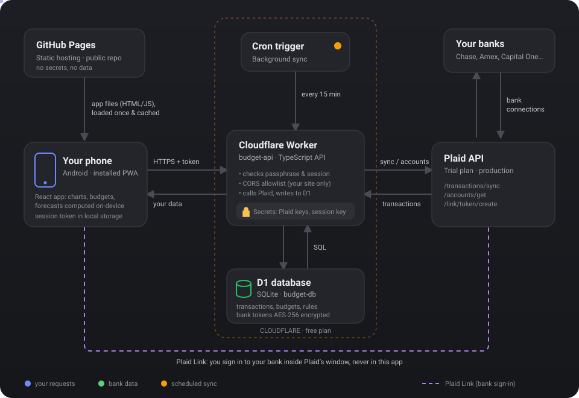
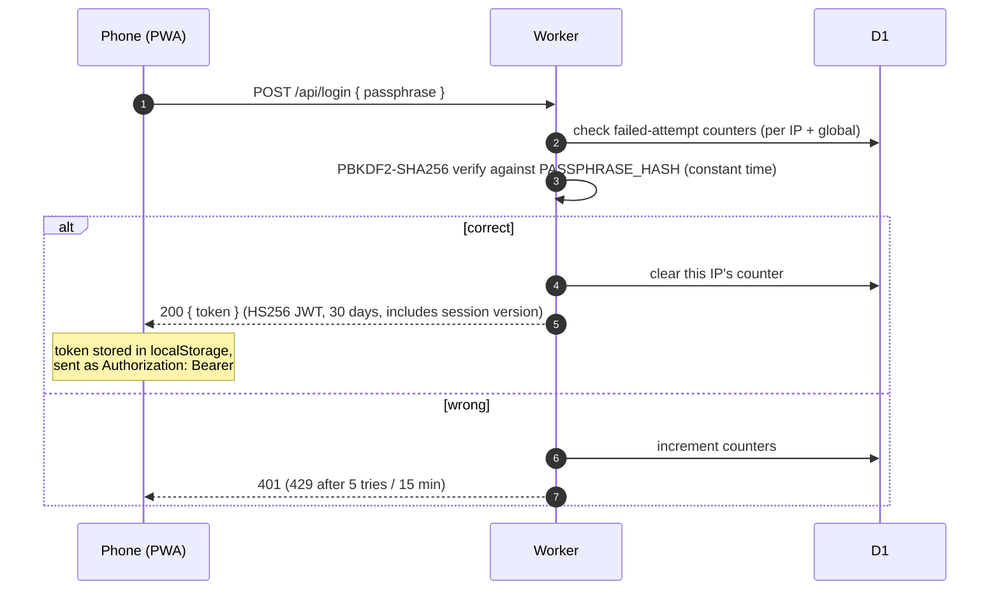
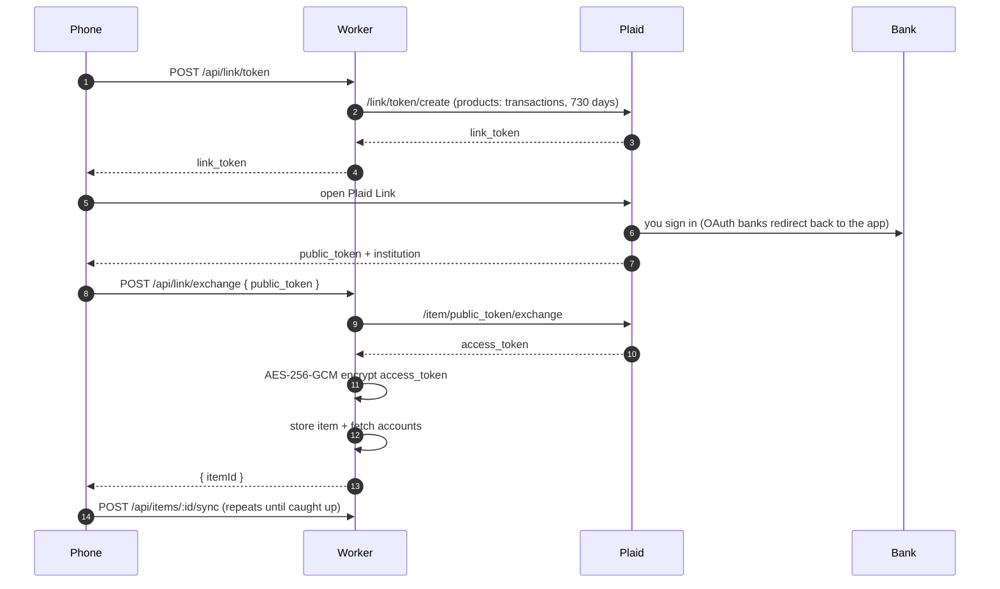
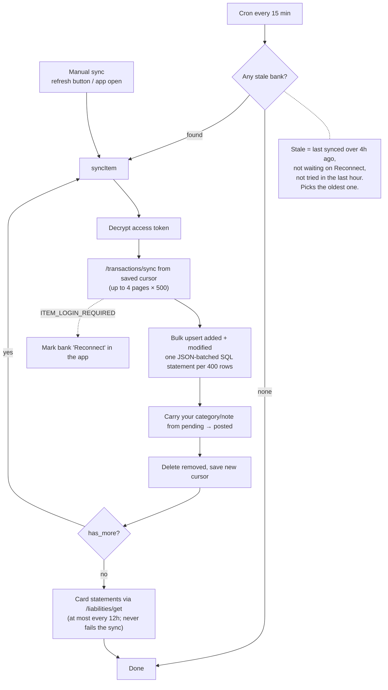
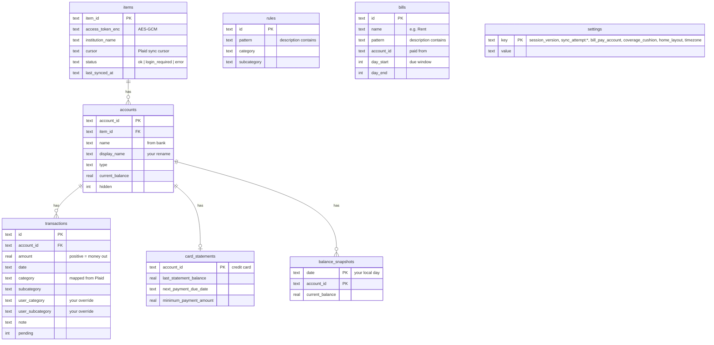

# Architecture



Budget is a single-user personal finance app. The phone app is a static site; everything that needs secrets or storage lives in one small Cloudflare Worker. There are no servers to manage and nothing runs unless a request or the schedule wakes it up.

| Piece | What it is | Where it lives |
| --- | --- | --- |
| Web app | React + TypeScript PWA built with Vite | `web/` → GitHub Pages |
| API | Cloudflare Worker (TypeScript, no framework) | `worker/src` → `budget-api.<you>.workers.dev` |
| Database | Cloudflare D1 (SQLite) | `budget-db`, schema in `worker/migrations` |
| Secrets | Worker secrets (encrypted by Cloudflare) | set with `wrangler secret put` |
| Bank data | Plaid (Trial plan, production) | called only by the Worker |
| Background sync | Cloudflare Cron Trigger, every 15 min | `triggers` in `worker/wrangler.jsonc` |

## Design principles

- **Secrets never reach the browser.** The Plaid client ID/secret, the session signing key, and the token encryption key exist only as Worker secrets. The repo is public and contains none of them.
- **Private by default.** Every API route except `/api/health` and `/api/login` requires a valid session. Only the GitHub Pages origin is allowed by CORS, and state-changing requests from any other origin are rejected.
- **Bank credentials never touch this app.** You sign in to banks inside Plaid Link (Plaid's own window). The app only ever receives a one-time `public_token`, which the Worker exchanges for an access token.
- **Analytics run on the phone.** Charts, forecasts, insights, recurring-charge detection and auto-categorize rules are computed in the browser from data the app already loaded. No transaction data is sent to any third-party service.
- **Stay inside the free tier.** Sync work is chunked so each Worker run stays under the free plan's subrequest and CPU limits.

## Request flows

### Signing in



Every later request is checked for a valid signature, an unexpired token, and a session version that matches the database. **Sign out on all devices** bumps that version, which instantly invalidates every issued token.

### Linking a bank



### Syncing transactions

Two things trigger a sync: **you** (the refresh button, opening the app when data is more than 6 hours old, or right after linking) and **the cron trigger** (every 15 minutes).



Sync is **incremental**: Plaid's cursor means each run only fetches what changed since the last one, and nothing is lost if the app isn't opened for a while. Plaid itself refreshes data from banks a few times a day; our sync pulls whatever Plaid has.

The cron runs one bank per run because free-plan Workers allow about 50 subrequests per invocation. With the Trial plan's 10-bank cap, every bank still refreshes several times a day.

## Data model



**How a transaction's category is decided**, highest priority first:

1. Your manual choice (`user_category` / `user_subcategory`), set from the transaction sheet
2. An auto-categorize **rule** whose pattern appears in the merchant or description (longest pattern wins)
3. Plaid's `personal_finance_category`, mapped to the app's categories in `worker/src/categories.ts`

Rules are applied when data loads rather than written into each row, so a new rule fixes past transactions too and deleting a rule cleanly undoes it. Syncs never overwrite your overrides, account renames, or hidden flags.

## On-device analytics

All in `web/src/`:

| Feature | File | Approach |
| --- | --- | --- |
| Cash flow, categories | `calc.ts` | Sums over the selected period; transfers and card payments excluded |
| Balance history | `calc.ts` | Uses the daily balance snapshot for each account where one exists (captures market moves and interest), and walks back through posted transactions between and before snapshots. Snapshots are written on every sync and filled in once a day by the cron, dated in your timezone |
| Recurring charges | `recurring.ts` | Groups by merchant; schedule and amount come from the **last 3 charges**, so changes (e.g. $250 weekly → $400 every 2 weeks) are picked up within a couple of cycles and noted. Needs a regular schedule over the last 5 gaps (or a clean switch between two schedules) and exact-repeat amounts, so frequent-but-random purchases aren’t mistaken for subscriptions |
| Tracked bills | `recurring.ts` | Bills you mark by hand (e.g. rent via Bilt, 1st–5th): matched by description + account, amount = average of the last 3 payments, due at the start of the next unpaid window |
| Upcoming bills (coverage) | `coverage.ts` | Bill-pay account balance (auto-detected from where card payments come from) minus card statements still owed (statement balance − payments since it was issued), tracked bills and recurring charges from that account over 30 days, plus recurring deposits into it; flags when the running balance dips below your cushion |
| End-of-month forecast | `insights.ts` | Spent so far + recurring charges still due + daily pace × days left. The pace blends your recent 90-day average with this month's, trusting this month more as it goes on; one-off big purchases are capped so they don't skew it. Tap the card for the chart and the full calculation |
| Unusual this month | `insights.ts` | Compares each category with the same point in your last 3 months; adds biggest purchase, new merchants, price increases, missing subscriptions |
| Auto-categorize | `rules.ts` | Case-insensitive "contains" match, applied at load time |

## Security summary

| Threat | Mitigation |
| --- | --- |
| Someone finds the API URL | Every data route requires a signed, unexpired, unrevoked session |
| Passphrase guessing | PBKDF2 hash, constant-time compare, 5 tries / 15 min per IP, 25 / hour globally |
| Another website calling the API from your browser | Strict CORS allowlist + origin check on all writes |
| Database leak | Plaid access tokens are AES-256-GCM encrypted with a key that lives only in Worker secrets |
| Leaked session token | 30-day expiry; "Sign out on all devices" revokes all tokens immediately |
| Injected scripts in the page | Content-Security-Policy limits scripts to the app and Plaid's CDN |
| Secrets in git | None in the repo; `.dev.vars` is git-ignored |

## Repo layout

```
web/                    React PWA (GitHub Pages)
  src/pages/            Home, Categories, Analytics, Transactions, Accounts, Recurring, Rules
  src/components/       Charts, sheets, filters, Plaid Link
  src/calc.ts           Totals, balances
  src/insights.ts       Recurring detection, forecast, unusual-spending insights
  src/rules.ts          Auto-categorize rules
worker/                 Cloudflare Worker API
  src/index.ts          Routes, scheduled sync
  src/auth.ts           Login, sessions, rate limiting
  src/crypto.ts         PBKDF2, JWT, AES-GCM
  src/plaid.ts          Plaid client
  src/sync.ts           Incremental transaction sync
  src/categories.ts     Plaid → app category mapping
  migrations/           D1 schema
  scripts/              Passphrase/secret generator
.github/workflows/      Build + deploy web app to GitHub Pages
docs/                   This document and the diagram
```

## Deploying changes

Run these from the project root:

| Changed | Run |
| --- | --- |
| `web/**` | `git push` (GitHub Actions builds and deploys Pages) |
| `worker/**` (code, `wrangler.jsonc`, or a new migration) | `npm run deploy:worker`, which applies pending migrations, then deploys |
| A secret | `cd worker && npx wrangler secret put NAME` |

When a change touches both, deploy the Worker **before** pushing, so the new web app never talks to an older API.

If `wrangler` reports an auth error such as code 7403, the local login has expired. Run `npx wrangler login` again.

**Optional automation:** [`docs/ci-cd/`](ci-cd/README.md) contains a ready-made workflow that deploys migrations, the Worker and the web app on every push, along with the security tradeoffs of storing a Cloudflare token in GitHub. It's not enabled.
