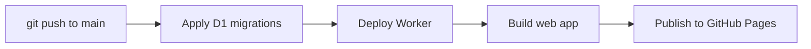

# Optional: fully automated deploys

**Status: not enabled.** Today the web app deploys automatically on push, and the Worker + database are deployed by hand. This folder holds a ready-to-use workflow that automates the backend too, plus what to weigh before turning it on.

## Today vs. with this workflow

| | Today | With `deploy.yml` |
| --- | --- | --- |
| Web app (GitHub Pages) | Automatic on push (`.github/workflows/deploy-web.yml`) | Automatic on push |
| D1 migrations | Manual: `npm run db:migrate:remote` | Automatic, before the Worker deploys |
| Worker | Manual: `npm run deploy:worker` (runs migrations, then deploys) | Automatic, before the web app deploys |
| Where Cloudflare credentials live | Your machine only (`wrangler login`) | Your machine **and** an encrypted GitHub secret |

The workflow runs three jobs in order, so a web change never goes live before the API it depends on:



Migrations only apply ones that haven't run yet, and the Worker deploy keeps the secrets you set with `wrangler secret put`, so re-running the workflow is safe.

## The tradeoff

The token can deploy Worker code and edit the D1 database. Because the Worker is what holds your Plaid secret and the key that decrypts stored bank tokens, **anyone with this token could deploy code that reads your financial data**. It can't read secret values directly, touch billing or DNS, or move money (Plaid access is read-only).

Ways it could leak, and what limits each:

| Risk | Mitigation |
| --- | --- |
| Someone takes over your GitHub account | Turn on GitHub 2FA. (A hijacked repo is already a risk without the token, since it controls the web app.) |
| A compromised Action or npm package reads the token during a run | The token is only given to the two Cloudflare steps, not `npm ci`. Optionally pin actions to commit SHAs. |
| A pull request from a stranger | GitHub doesn't pass secrets to workflows from forks, and this one only runs on pushes to `main`. |
| The token leaks some other way | Give it an expiry (TTL), and roll/delete it in Cloudflare if anything looks off. Cloudflare's audit log shows every deploy. |

For comparison, the `wrangler login` session on your machine already has **broader** access (your whole Cloudflare account) than this token would.

## How to enable it

### 1. Create a Cloudflare API token

1. Cloudflare dashboard → profile icon → **My Profile → API Tokens** (<https://dash.cloudflare.com/profile/api-tokens>) → **Create Token**.
2. Next to **Edit Cloudflare Workers**, click **Use template**.
3. **Permissions → + Add more → Account · D1 · Edit** (the template doesn't include D1; migrations need it).
4. **Account Resources:** Include → your account.
5. **Zone Resources:** Include → All zones from an account → your account (unused here, but the template requires it).
6. **TTL:** set an expiry, e.g. one year.
7. **Continue to summary → Create Token**, and copy it. Cloudflare only shows it once.

### 2. Find your account ID

It's the long ID right after `dash.cloudflare.com/` in the dashboard URL, also shown with a copy button under **Workers & Pages**.

### 3. Add GitHub secrets

Repo → **Settings → Secrets and variables → Actions → Secrets** tab (not Variables) → **New repository secret**:

| Name | Value |
| --- | --- |
| `CLOUDFLARE_API_TOKEN` | the token |
| `CLOUDFLARE_ACCOUNT_ID` | your account ID |

Keep the existing `VITE_API_URL` **variable** as-is; the new workflow uses it too.

### 4. Swap the workflow

```bash
cp docs/ci-cd/deploy.yml.template .github/workflows/deploy.yml
git rm .github/workflows/deploy-web.yml   # otherwise Pages deploys twice per push
git add .github/workflows/deploy.yml
git commit -m "Automate Worker + migrations + web deploys"
git push
```

Then check the **Actions** tab. The first run should show all three jobs passing. If the Worker job fails with an auth error, the token is usually missing the D1 permission or scoped to the wrong account.

You can delete the leading `# TEMPLATE` comment in the copied file.

## Turning it back off

1. Delete `.github/workflows/deploy.yml` and restore `deploy-web.yml` from this repo's history (`git checkout <commit> -- .github/workflows/deploy-web.yml`).
2. Delete both Cloudflare secrets in GitHub.
3. **Delete or roll the token** in Cloudflare (My Profile → API Tokens). Removing it from GitHub alone doesn't revoke it.
